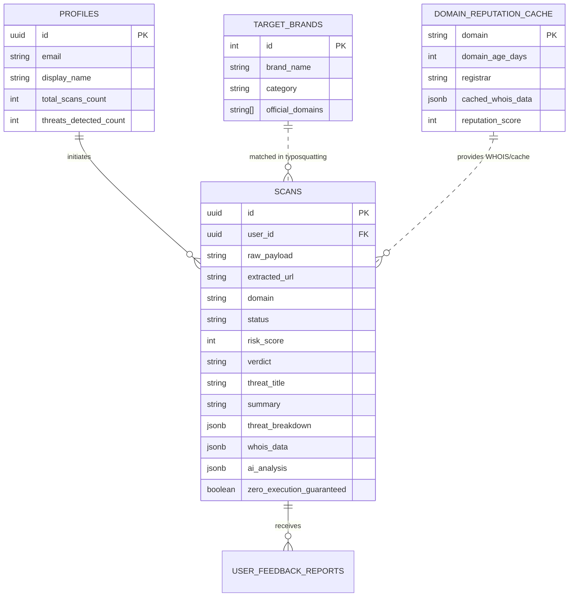

# QuishGuard: Supabase Backend Setup

This directory contains the database schema, security rules, seed data, and TypeScript interfaces for the **QuishGuard** backend.

---

## 1. Quick Setup in Supabase

1. Open your [Supabase Project Dashboard](https://supabase.com/dashboard).
2. Go to the **SQL Editor** on the left menu.
3. Paste the contents of [`schema.sql`](file:///C:/Users/vlaru/.gemini/antigravity/scratch/quishguard/supabase/schema.sql) and click **Run**.
4. Paste the contents of [`seed.sql`](file:///C:/Users/vlaru/.gemini/antigravity/scratch/quishguard/supabase/seed.sql) and click **Run** to populate benchmark brands and test threat scans.
5. In **Storage**, verify that the `qr-codes` bucket was created with public read access (the script automatically inserts this into `storage.buckets`).

---

## 2. Database Architecture



---

## 3. The 4-Layer Threat Scoring Architecture (0 - 100%)

The backend is built around the problem statement's **Multi-Layer Threat Evaluation**:

| Layer | Weight | What it checks |
|---|---|---|
| **Layer 1: Heuristics & Static URL Checks** | 0 - 25 pts | Raw IP hosts (e.g. `http://194.x.x.x`), unencrypted HTTP, non-standard ports, `@` symbol credential tricks, deep subdomains, suspicious TLDs (`.top`, `.xyz`, `.online`), dangerous extensions (`.exe`, `.apk`, `.vbs`). |
| **Layer 2: Typosquatting & Brand Spoofing** | 0 - 25 pts | Levenshtein distance, character substitutions (`paypa1`, `micros0ft`), homoglyphs / Punycode against high-value target brands stored in `target_brands`. |
| **Layer 3: Domain Age & WHOIS Intelligence** | 0 - 25 pts | Domain registration date. Domains younger than 14 days receive maximum risk penalties. Anonymous registrar privacy shields and bulletproof hosting networks are flagged. |
| **Layer 4: Gemini AI Threat Analysis** | 0 - 25 pts | Gemini assesses the full semantic context, path structure, query parameters, attack vector (credential harvesting, OAuth phishing, drive-by download), and synthesizes a human-readable safety verdict. |

**Final Composite Verdict**:
- `0 - 29`: **SAFE** (Green)
- `30 - 49`: **LOW_RISK** (Blue/Light Green)
- `50 - 69`: **SUSPICIOUS** (Yellow/Orange)
- `70 - 89`: **MALICIOUS** (Red)
- `90 - 100`: **CRITICAL** (Dark Red / Alert)

---

## 4. Environment Variables Needed

Create a `.env.local` file in your frontend root:

```env
# Supabase
NEXT_PUBLIC_SUPABASE_URL=https://your-project-ref.supabase.co
NEXT_PUBLIC_SUPABASE_ANON_KEY=eyJhbGciOi...
SUPABASE_SERVICE_ROLE_KEY=eyJhbGciOi... # Keep server-side only

# Gemini API (for Layer 4 AI Threat Analysis)
GEMINI_API_KEY=AIzaSy...

# Optional WHOIS API (or fallback to free RDAP)
WHOIS_API_KEY=...
```

---

## 5. TypeScript Integration

Import type definitions directly into your app components or API routes:

```typescript
import type { Scan, ThreatBreakdown, ScanVerdict } from './supabase/types';
```
